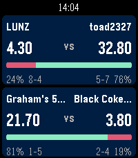
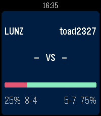
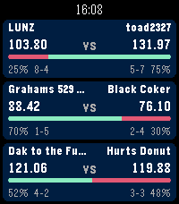
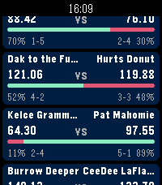

# Fantasy Football for Pebble Time 2

Follow all your fantasy leagues from your wrist. Every league you pick gets a
matchup card: team names on each side, the live score in the middle, and a
red/green bar showing win probability.






Two leagues mid-game, then a single league before kickoff — until the first
game starts there is nothing to show but the odds, so the scores read
`-  VS  -` and only the win-probability bar carries information.

Currently supports **Sleeper**. The platform is `emery` (Pebble Time 2,
200x228, 64-colour).

## How the screen divides

The cards split the screen by how many leagues you follow, so two leagues stay
readable instead of being squeezed into a list:

| Leagues | Each card | Behaviour |
|---------|-----------|-----------|
| 1 | full screen | — |
| 2 | 50% | — |
| 3 | a third | — |
| 4+ | a third | scrolls |

Past three leagues the content scrolls — by finger on the touchscreen, or with
the Up/Down buttons. Select forces a refresh.

## Settings

Open the app's settings, type your Sleeper username, and tick the leagues you
want. Nothing needs an account or an API key: Sleeper's read API is public.

## Win probability

Sleeper's API exposes no win-probability field, so this computes one:

1. Take each team's live score.
2. Add up Sleeper's projections for the starters who have not played yet.
3. Treat the projected margin as normal with σ = `9.0 × sqrt(players left)`
   and read the win probability off the normal CDF.

Before kickoff that reproduces the direction and rough magnitude of Sleeper's
own number — including the common case where the team with the better record
is the underdog this week. It is a model, not Sleeper's model, so it will not
match their figure exactly.

Scoring type is detected per league from `scoring_settings.rec`
(PPR / half-PPR / standard).

## Building

Needs the [Pebble SDK](https://developer.repebble.com/) and `pebble` tool.

```bash
pebble build --sdk 4.33.1                        # for a real Pebble Time 2
pebble install --phone <ip>                      # sideload
```

### A note on SDK versions

The touch-scrolling path differs by SDK, and `src/c/main.c` compiles both ways
off `_PBL_API_EXISTS_pan_recognizer_create`:

- **SDK 4.33+** — a vertical `pan_recognizer` drives the `ScrollLayer`, with
  `window_set_touch_bridge_disabled()` so the recognizer receives the touch
  stream. This is the correct path, and what a real watch should run. A bare
  `ScrollLayer` does not scroll by touch on its own.
- **Older SDKs** — the same scrolling is hand-rolled from raw
  `touch_service_subscribe()` events.

The fallback exists for a practical reason: at the time of writing the 4.33.1
emery firmware does not boot in the QEMU emulator, so emulator testing happens
on 4.9.169:

```bash
pebble build --sdk 4.9.169
pebble install --emulator emery --sdk 4.9.169
pebble screenshot --no-open --emulator emery --sdk 4.9.169
```

## Settings page hosting

`config.html` is served from GitHub Pages at
https://pebble-fantasy-football.michaellunzer.com/config.html , and `CONFIG_URL` in
`src/pkjs/index.js` points at it. Sleeper's API sends
`Access-Control-Allow-Origin: *`, so the page queries it straight from the
browser with no proxy.

To test it against a local emulator instead:

```bash
pebble emu-app-config --emulator emery --sdk 4.9.169 --file config.html
```

## Licence / fair use

Sleeper's API is free for non-commercial use only. This project is not
affiliated with Sleeper.
